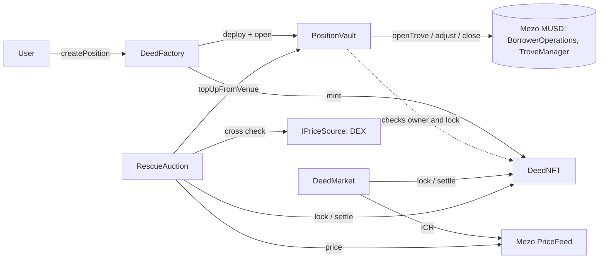

# Deed

A Mezo MUSD loan is stuck to the wallet that opened it, so you can't sell a healthy position or hand a risky one to
someone who will rescue it. Deed puts each loan in its own vault and makes control of that vault an NFT you can sell.

**Live demo:** `<add the deployed URL here>`

Built for the Mezo Buildathon. Mezo testnet, chain id 31611.

## Try it in 3 steps

1. **Run the app.** `cd frontend && cp .env.example .env.local`, put your own WalletConnect project id in it (the
   contract addresses are already filled in), then `npm install && npm run dev`.
2. **Open a position.** Connect a wallet on Mezo testnet with some test BTC (a MetaMask style wallet or Mezo Passport),
   and open a position, for example 0.04 BTC against 1,800 MUSD.
3. **Sell it.** List it for MUSD and buy it from a second wallet, or open one at about 117% ICR and start a rescue
   auction from the Rescue page. [docs/demo.md](docs/demo.md) walks through both and holds the transaction hashes of a
   full live run (`node --env-file=.env scripts/e2e.mjs` repeats it).

## Deployed addresses

Mezo testnet (31611), deployed with `script/Deploy.s.sol` in one broadcast with `DeedNFT.init` included, built for the
london EVM. Deploy transactions: [docs/demo.md](docs/demo.md) and `deployments.json`.

| Contract | Address | Source (Sourcify) |
| --- | --- | --- |
| DeedNFT | [`0x848063cbD0230B6A4345311Ec090FDb51F49b681`](https://explorer.test.mezo.org/address/0x848063cbD0230B6A4345311Ec090FDb51F49b681) | [exact match](https://repo.sourcify.dev/31611/0x848063cbD0230B6A4345311Ec090FDb51F49b681) |
| DeedFactory | [`0x25ADc1306C9ad1529EC00b14ED353B4B198eB8Fc`](https://explorer.test.mezo.org/address/0x25ADc1306C9ad1529EC00b14ED353B4B198eB8Fc) | [exact match](https://repo.sourcify.dev/31611/0x25ADc1306C9ad1529EC00b14ED353B4B198eB8Fc) |
| DeedMarket | [`0x7e8a3d9624A4b69b5ADCD362028422b85eDF2e99`](https://explorer.test.mezo.org/address/0x7e8a3d9624A4b69b5ADCD362028422b85eDF2e99) | [exact match](https://repo.sourcify.dev/31611/0x7e8a3d9624A4b69b5ADCD362028422b85eDF2e99) |
| RescueAuction | [`0x190fB7559BB8023ecAA7c90CFcC17187042B89F9`](https://explorer.test.mezo.org/address/0x190fB7559BB8023ecAA7c90CFcC17187042B89F9) | [exact match](https://repo.sourcify.dev/31611/0x190fB7559BB8023ecAA7c90CFcC17187042B89F9) |
| PairSpotPrice (DEX guard) | [`0xc8978277f2BCe7c06F9612d457c12B24F364Ec24`](https://explorer.test.mezo.org/address/0xc8978277f2BCe7c06F9612d457c12B24F364Ec24) | [exact match](https://repo.sourcify.dev/31611/0xc8978277f2BCe7c06F9612d457c12B24F364Ec24) |

The DEX guard reads the live Tigris MUSD/BTC volatile pool `0xd16A5Df82120ED8D626a1a15232bFcE2366d6AA9`. No mock price source
is used. Existing MUSD contracts used (checked on chain): MUSD `0x118917a40FAF1CD7a13dB0Ef56C86De7973Ac503`,
BorrowerOperations `0xCdF7028ceAB81fA0C6971208e83fa7872994beE5`, TroveManager `0xE47c80e8c23f6B4A1aE41c34837a0599D5D16bb0`,
PriceFeed `0x86bCF0841622a5dAC14A313a15f96A95421b9366`.

An earlier deployment is still on chain and is superseded, do not use it. It is listed under `previousDeployment` in
`deployments.json` and in [docs/first-deployment/](docs/first-deployment/README.md).

### Verification

The Mezo Blockscout verifier rejects every submission, including an unrelated control contract with no constructor and no
immutables, so the explorer pages show no source. Sourcify has an exact match (creation and runtime bytecode) for all five
contracts. The submissions, the control experiment and the reproduction commands are in
[docs/verification.md](docs/verification.md), and `scripts/verify.sh` repeats them.

## Safety rules

What the deployed contracts enforce, each with the test that shows it. More detail in [docs/security.md](docs/security.md).

- **Strangers start rescues only below 120% ICR.** Liquidation is at 110%, so a stranger can only act on a position that is
  within 10 points of it. The holder can start an auction at any ratio. Tests:
  `test_publicStart_onlyBelowOneTwentyPercent`, `test_awayOwnerAt125_cannotBeRescuedByStranger`.
- **Every auction floor is at least 80% of the equity, owners included.** `MIN_FLOOR_BPS` is 8,000 and `start` rejects
  anything lower, so a holder cannot be tricked into a near-zero sale either. Tests: `test_floor_cannotGoBelowEightyPercent`,
  `test_noAuctionCanBeStartedWithAnythingBelowTheMinimumFloor`, `testFuzz_strangerAuctionNeverPaysUnderEightyPercent`.
- **The oracle prices, the DEX only guards.** Equity, ICR and the top-up amount all come from the Mezo `PriceFeed`. The DEX
  spot price is compared with the oracle and the call reverts when they differ by more than the limit; it never enters an
  amount. Test: `test_priceComesFromOracle_notFromSpot`, and the live check in [docs/demo.md](docs/demo.md).
- **`DEVIATION_BPS=1000` (10%) is a testnet setting.** The testnet pool is not arbitraged against the oracle and sat about 3%
  under it at deploy time, so a tight limit would pause every rescue. Mainnet should use about 1 to 2% (100 to 200 bps) and a
  time-weighted price source instead of instant pool reserves. It is a constructor value, so it cannot be changed on this
  deployment.
- **A listing or an auction freezes the vault for everyone, the holder included.** While a venue holds the Deed, the vault
  refuses every action from every caller and the Deed cannot be transferred. Test: `test/FrozenVault.t.sol`
  (`test_listedVault_isFrozenForTheHolderAndEveryoneElse`, `test_auctionedVault_isFrozenForTheHolderAndEveryoneElse`,
  `testFuzz_frozenAgainstAnyCallerAnyAmount`).

## How it works

1. `DeedFactory.createPosition` deploys a `PositionVault`, mints a **Deed** (ERC-721) and opens the trove from the
   vault in one transaction. The vault is the trove's borrower, so the trove lives with the vault, not a wallet.
2. Whoever holds the Deed is the only one who can add collateral, repay, withdraw or close through the vault.
3. Sell the position:
   - **Fixed price** (`DeedMarket`): list for MUSD. The Deed is locked, so the vault is frozen to the seller. The buyer
     passes a snapshot hash of what they looked at and the sale reverts if the position differs.
   - **Rescue auction** (`RescueAuction`): when a position is close to liquidation a Dutch auction runs from the
     owner's equity down to a floor. The winner pays MUSD to the old owner and adds BTC in the same transaction so the
     position leaves above a safe ICR.

## Architecture



| Contract | Role |
| --- | --- |
| `DeedNFT` | ERC-721. `ownerOf` controls the vault. A venue can lock a token, and then only that venue can move it. |
| `PositionVault` | Owns one trove. Open, add collateral, repay, withdraw, close, claim surplus, all Deed-holder only. |
| `DeedFactory` | Deploys vault, mints Deed, opens trove. |
| `DeedMarket` | Fixed price listings with a buyer-protection snapshot. Pull payments. |
| `RescueAuction` | Dutch auction with an oracle check against a DEX price. Pull payments. |
| `PairSpotPrice` | `IPriceSource` for a Uniswap V2 / Velodrome style pair. |

## Security model

- No owner, no fee, no pause, no upgrade. The deployer calls `DeedNFT.init` once to register the factory and venues.
- A sale reverts if collateral, principal, rate or the promised minimum ICR changed since the buyer looked, and if
  live ICR from the Mezo `PriceFeed` is below the promise at settlement.
- Payments are credited and pulled. Reentrancy guards plus checks-effects-interactions, tested with a hook token.
- Review findings and what was done about them: [docs/security.md](docs/security.md). Research on the MUSD contracts:
  [docs/mezo-notes.md](docs/mezo-notes.md).

## Develop

```
forge build
forge test --no-match-path 'test/fork/*'   # unit, fuzz, invariants against mocks
forge test --match-path 'test/fork/*'      # real MUSD contracts on a testnet fork
cd frontend && npm test                    # price source range check
```

## Limitations

- Not audited.
- The snapshot hashes the principal, not total debt. Total debt changes every second through interest, so it would
  never match. Interest is covered by the minimum ICR check.
- A partial redemption against a listed trove makes `buy` revert until the listing is cancelled and relisted.
- A stranger can start a rescue auction only under 120% ICR, with a floor of 80% of the equity. The owner can top up
  and cancel.
- The DEX cross check uses pool reserves, which can be moved in one transaction. It can only make calls revert, it
  never sets a price. Mezo's oracle must be correct and fresh (it reverts after 60 seconds).
- Liquidated positions can't be sold. Surplus collateral is claimed from the vault.
- No `refinance`: a position keeps the interest rate it was opened with.
- The frontend lists the latest 60 Deeds by reading the chain directly, there is no indexer.
- Mezo's testnet RPC sometimes returns the bare 21k base cost from `eth_estimateGas` (reproduce with `scripts/estimate-probe.mjs`).
  A wallet that trusts it sends transactions that run out of gas. The app simulates first and sets its own gas limit, but
  a wallet that estimates on its own can still hit this.
- The wallet list is Passport's defaults plus an injected-wallet entry. WalletConnect needs a real project id in
  `NEXT_PUBLIC_WC_PROJECT_ID`. Extension wallets (MetaMask, Unisat, OKX, Xverse) were not tested.
