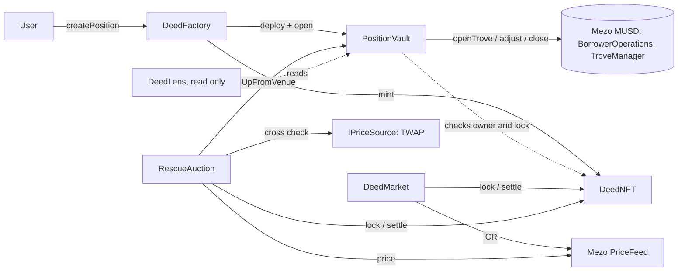

# Deed

A Mezo MUSD loan is stuck to the wallet that opened it, so you can't sell a healthy position or hand a risky one to
someone who will rescue it. Deed puts each loan in its own vault and makes control of that vault an NFT you can sell.

**Live demo:** [frontend-iota-blush-70.vercel.app](https://frontend-iota-blush-70.vercel.app)

Built for the Mezo Buildathon. Mezo testnet, chain id 31611.

## Try it in 3 steps

1. **Open the live app and connect.** Go to https://frontend-iota-blush-70.vercel.app and connect a wallet on Mezo
   testnet (chain id 31611) with test BTC from the [Mezo faucet](https://faucet.test.mezo.org/).
2. **Open a position.** On My Positions, open one, for example 0.04 BTC against 1,800 MUSD.
3. **Sell it.** List it for MUSD and buy it from a second wallet, or open one at about 117% ICR and start a rescue
   auction from the Rescue page. [docs/demo.md](docs/demo.md) walks through both and holds the transaction hashes of a
   full live run (`node --env-file=.env scripts/e2e.mjs` repeats it).

### Run locally

`cd frontend && cp .env.example .env.local`, put your own WalletConnect project id in it (the contract addresses are
already filled in), then `npm install && npm run dev`.

## Deployed addresses

Mezo testnet (31611), third deployment (v3), deployed with `script/Deploy.s.sol` in one broadcast with `DeedNFT.init`
included, built for the london EVM. Deploy transactions: [docs/demo.md](docs/demo.md) and `deployments.json`.

| Contract | Address | Source (Sourcify) |
| --- | --- | --- |
| DeedNFT | [`0x9C92E662cB7de018162E1d06F1f977f6A0B5547f`](https://explorer.test.mezo.org/address/0x9C92E662cB7de018162E1d06F1f977f6A0B5547f) | [exact match](https://repo.sourcify.dev/31611/0x9C92E662cB7de018162E1d06F1f977f6A0B5547f) |
| DeedFactory | [`0xb8602DBF0e5BBDE81C504C87F860fbbe7DF125CD`](https://explorer.test.mezo.org/address/0xb8602DBF0e5BBDE81C504C87F860fbbe7DF125CD) | [exact match](https://repo.sourcify.dev/31611/0xb8602DBF0e5BBDE81C504C87F860fbbe7DF125CD) |
| DeedMarket | [`0x862e105bDE51B27c3B9670810c5B9Ea3b470Cbdd`](https://explorer.test.mezo.org/address/0x862e105bDE51B27c3B9670810c5B9Ea3b470Cbdd) | [exact match](https://repo.sourcify.dev/31611/0x862e105bDE51B27c3B9670810c5B9Ea3b470Cbdd) |
| RescueAuction | [`0xbF4Fe3aF0C5c138AE28230AF1Cb9b0C8cf2c8355`](https://explorer.test.mezo.org/address/0xbF4Fe3aF0C5c138AE28230AF1Cb9b0C8cf2c8355) | [exact match](https://repo.sourcify.dev/31611/0xbF4Fe3aF0C5c138AE28230AF1Cb9b0C8cf2c8355) |
| DeedLens (read only) | [`0xDd628bBb4663549E0Af7815E93D14002D1f9Dde1`](https://explorer.test.mezo.org/address/0xDd628bBb4663549E0Af7815E93D14002D1f9Dde1) | [exact match](https://repo.sourcify.dev/31611/0xDd628bBb4663549E0Af7815E93D14002D1f9Dde1) |
| PairTwapPrice (DEX guard) | [`0xda3e5a7785Ba49B87B5884dB7662e44Af31f4d00`](https://explorer.test.mezo.org/address/0xda3e5a7785Ba49B87B5884dB7662e44Af31f4d00) | [exact match](https://repo.sourcify.dev/31611/0xda3e5a7785Ba49B87B5884dB7662e44Af31f4d00) |

Fees: 0.5% of the sale price on `DeedMarket` and 0.5% of the winning price on `RescueAuction`, both constructor values
(capped at 1% by the contracts), paid to the immutable treasury `0x4989CC7150a869D6b07540B54B96fD02c5e0537c` with `claim()`.
The ABIs are in [`abis/`](abis) and described in [docs/interfaces.md](docs/interfaces.md).

The DEX guard is a time weighted price (1 hour window) from the live Tigris MUSD/BTC volatile pool
`0xd16A5Df82120ED8D626a1a15232bFcE2366d6AA9`. No mock price source is used. Existing MUSD contracts used (checked on chain):
MUSD `0x118917a40FAF1CD7a13dB0Ef56C86De7973Ac503`, BorrowerOperations `0xCdF7028ceAB81fA0C6971208e83fa7872994beE5`,
TroveManager `0xE47c80e8c23f6B4A1aE41c34837a0599D5D16bb0`, PriceFeed `0x86bCF0841622a5dAC14A313a15f96A95421b9366`.

Earlier deployments are still on chain and are superseded, do not use them. The second (v2) is marked `superseded` under
`previousDeployments` in `deployments.json`, the first is in [docs/first-deployment/](docs/first-deployment/README.md).

### Verification

Sourcify has an exact match (creation and runtime bytecode) for all six v3 contracts. The Mezo explorer's API now returns
source and ABI for them as well. See [docs/verification.md](docs/verification.md); `scripts/verify.sh` repeats the checks.

## Safety rules

What the deployed contracts enforce, each with the test that shows it. More detail in [docs/security.md](docs/security.md).

- **Strangers start rescues only below 120% ICR.** Liquidation is at 110%, so a stranger can only act on a position that is
  within 10 points of it. The holder can start an auction at any ratio. Tests:
  `test_publicStart_onlyBelowOneTwentyPercent`, `test_awayOwnerAt125_cannotBeRescuedByStranger`.
- **Every auction floor is at least 80% of the equity, owners included.** `MIN_FLOOR_BPS` is 8,000 and `start` rejects
  anything lower, so a holder cannot be tricked into a near-zero sale either. Tests: `test_floor_cannotGoBelowEightyPercent`,
  `test_noAuctionCanBeStartedWithAnythingBelowTheMinimumFloor`, `testFuzz_strangerAuctionNeverPaysUnderEightyPercent`.
- **The oracle prices, the DEX only guards.** Equity, ICR and the top-up amount all come from the Mezo `PriceFeed`. The DEX
  spot price is compared with the oracle and the call reverts when they differ by more than the limit; it never enters an
  amount. Test: `test_priceComesFromOracle_notFromSpot`, and the live check in [docs/demo.md](docs/demo.md).
- **The guard is a time weighted price, and 200 bps is the target.** v3 compares the oracle with an average of the Tigris
  pool's own observations over at least an hour, so a one-block reserve swing cannot reach it. The code and script default to
  `DEVIATION_BPS=200`, but the testnet pool is not arbitraged and sat about 9% off the oracle at deploy time, so this testnet
  deployment uses `maxDeviationBps = 2000` (20%). Mainnet should use 200 or less. Tests: `test_oneBlockReserveSpike_doesNotMoveTheAverage`,
  `test_instantSourceIsCensorable_twapIsNot`.
- **Closing, selling and rescuing use the entire debt.** Debt and collateral include pending redistribution everywhere, the
  `closeTrove` amount, the market snapshot, the ICR checks and the rescue equity. v2 under-pulled MUSD on `close()` when a
  redistribution was pending. Tests: `test_close_paysTheEntireDebtIncludingPendingRedistribution` and the fork test on the real
  MUSD contracts, `test_realMusd_closePaysTheEntireDebtIncludingPending`.
- **Fees are capped constants.** At most 1% of a sale price or winning price, set at deploy, to an immutable treasury, pulled
  not pushed; fee plus seller proceeds is always exactly the price. Tests: `testFuzz_marketFeePlusProceedsEqualsPrice`,
  `invariant_escrowEqualsClaimable`.
- **A listing or an auction freezes the vault for everyone, the holder included.** While a venue holds the Deed, the vault
  refuses every action from every caller and the Deed cannot be transferred. Test: `test/FrozenVault.t.sol`
  (`test_listedVault_isFrozenForTheHolderAndEveryoneElse`, `test_auctionedVault_isFrozenForTheHolderAndEveryoneElse`,
  `testFuzz_frozenAgainstAnyCallerAnyAmount`).

## How it works

1. `DeedFactory.createPosition` deploys a `PositionVault`, mints a **Deed** (ERC-721) and opens the trove from the
   vault in one transaction. The vault is the trove's borrower, so the trove lives with the vault, not a wallet.
2. Whoever holds the Deed is the only one who can add collateral, repay, withdraw, borrow more, refinance, close or claim
   surplus through the vault.
3. Sell the position:
   - **Fixed price** (`DeedMarket`): list for MUSD. The Deed is locked, so the vault is frozen to the seller. The buyer
     passes a snapshot hash of what they looked at and the sale reverts if the position differs. 0.5% fee.
   - **Rescue auction** (`RescueAuction`): when a position is close to liquidation a Dutch auction runs from the
     owner's equity down to a floor. The winner pays MUSD to the old owner and adds BTC in the same transaction so the
     position leaves above a safe ICR.

## Architecture



| Contract | Role |
| --- | --- |
| `DeedNFT` | ERC-721. `ownerOf` controls the vault. A venue can lock a token, and then only that venue can move it. |
| `PositionVault` | Owns one trove. Open, add collateral, repay, withdraw, borrow, refinance, close, claim surplus, all Deed-holder only. |
| `DeedFactory` | Deploys vault, mints Deed, opens trove. |
| `DeedMarket` | Fixed price listings with a buyer-protection snapshot and a capped fee. Pull payments. |
| `RescueAuction` | Dutch auction with an oracle check against a time weighted DEX price and a capped fee. Pull payments. |
| `DeedLens` | Read only. One call returns a position's collateral, entire debt, ICR, rate, equity, surplus, the system TCR and whether Recovery Mode is on, plus what Mezo currently allows. |
| `PairTwapPrice` | `IPriceSource` that averages a Tigris / Velodrome pool's cumulative reserves. (`PairSpotPrice`, the instant version, is kept for reference.) |

## Security model

- No owner, no pause, no upgrade. The only fees are the capped constructor constants above. The deployer calls `DeedNFT.init` once, in the
  deploy broadcast, to register the factory and venues.
- A sale reverts if collateral, principal, rate or the promised minimum ICR changed since the buyer looked, and if
  live ICR from the Mezo `PriceFeed` is below the promise at settlement.
- Payments are credited and pulled. Reentrancy guards plus checks-effects-interactions, tested with a hook token.
- Review findings and what was done about them: [docs/security.md](docs/security.md). Research on the MUSD contracts:
  [docs/mezo-notes.md](docs/mezo-notes.md).

## Develop

```bash
forge build
forge test --no-match-path 'test/fork/*'   # unit, fuzz, invariants against mocks
forge test --match-path 'test/fork/*'      # real MUSD contracts on a testnet fork
cd frontend && npm test                    # price source range check
```

## Limitations

- Not audited.
- The snapshot hashes the entire collateral and the entire principal (pending redistribution included), not total debt. Total
  debt changes every second through interest, so it would never match. Interest is covered by the minimum ICR check.
- A redistribution after listing changes the snapshot, so `buy` reverts until the seller relists.
- A partial redemption against a listed trove makes `buy` revert until the listing is cancelled and relisted.
- A stranger can start a rescue auction only under 120% ICR, with a floor of 80% of the equity. The owner can top up
  and cancel.
- The DEX cross check is a one-hour time weighted average, so it lags real moves and can refuse a call until the pool catches
  up. It can only make calls revert, it never sets a price. Mezo's oracle must be correct and fresh (it reverts after 60 seconds).
- Liquidated positions can't be sold. Surplus collateral only exists after a redemption closes a trove completely (a
  liquidation leaves none in this MUSD version) and is claimed from the vault with `claimSurplus`.
- In Mezo's Recovery Mode the vault refuses `withdraw`, `borrow` and `refinance` with `RecoveryModeActive`, and `close` while
  BorrowerOperations can mint. Adding collateral, repaying and selling still work.
- Closing with pending redistribution is covered by mock and fork tests but could not be shown on live testnet, where the
  Stability Pool is large enough that liquidations never redistribute.
- The DEX guard limit on this testnet deployment is 20%, wider than the 200 bps target, because the testnet pool is far from the
  oracle (see Safety rules). It is fixed at deploy.
- The fee applies only to venue sales, a Deed can still be handed over with a plain ERC-721 transfer.
- A testnet redemption bot closed the lowest-ICR positions of both the second and third deployments within blocks, see
  [docs/demo.md](docs/demo.md).
- The frontend lists the latest 60 Deeds by reading the chain directly, there is no indexer.
- Mezo's testnet RPC sometimes returns the bare 21k base cost from `eth_estimateGas` (reproduce with `scripts/estimate-probe.mjs`).
  A wallet that trusts it sends transactions that run out of gas. The app simulates first and sets its own gas limit, but
  a wallet that estimates on its own can still hit this.
- The wallet list is Passport's defaults plus an injected-wallet entry. WalletConnect needs a real project id in
  `NEXT_PUBLIC_WC_PROJECT_ID`. Extension wallets (MetaMask, Unisat, OKX, Xverse) were not tested.
