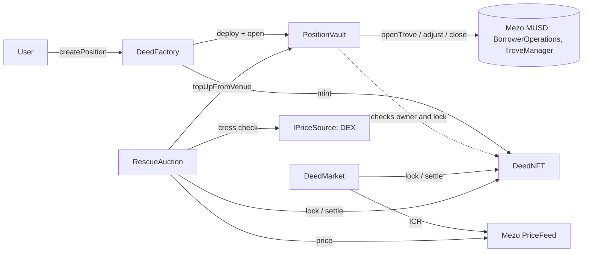

# Deed

A marketplace for Mezo borrowing positions, built for the Mezo Buildathon.

## Problem

A Mezo MUSD trove is tied to the address that opened it. You can't hand it to someone else, so you can't sell a
healthy loan, pass one on, or let someone take over a position that is about to be liquidated. The only exit is to
repay and close.

## How it works

1. `DeedFactory.createPosition` deploys a `PositionVault`, mints a **Deed** (ERC-721) and opens the trove from the
   vault in one transaction. The vault is the trove's borrower, so the trove lives with the vault, not a wallet.
2. Whoever holds the Deed is the only one who can add collateral, repay, withdraw or close through the vault.
3. Sell the position:
   - **Fixed price** (`DeedMarket`): list for MUSD. The Deed is locked, so the vault is frozen to the seller. The buyer
     passes a snapshot hash of what they looked at and the sale reverts if the position differs.
   - **Rescue auction** (`RescueAuction`): when a position is close to liquidation a Dutch auction runs from the
     owner's equity down to a floor. The winner pays MUSD to the old owner and adds BTC in the same transaction so the
     position leaves above a safe ICR.

## Architecture



| Contract | Role |
| --- | --- |
| `DeedNFT` | ERC-721. `ownerOf` controls the vault. A venue can lock a token, and then only that venue can move it. |
| `PositionVault` | Owns one trove. Open, add collateral, repay, withdraw, close, claim surplus, all Deed-holder only. |
| `DeedFactory` | Deploys vault, mints Deed, opens trove. |
| `DeedMarket` | Fixed price listings with a buyer-protection snapshot. Pull payments. |
| `RescueAuction` | Dutch auction with an oracle check against a DEX price. Pull payments. |
| `PairSpotPrice` | `IPriceSource` for a Uniswap V2 / Velodrome style pair. |

## Security model

Short version, the details are in [docs/security.md](docs/security.md):

- No owner, no fee, no pause, no upgrade. The deployer calls `DeedNFT.init` once to register the factory and venues.
- A listed or auctioned Deed is locked: the holder can't transfer it or touch the vault until the venue releases it.
- A sale reverts if collateral, principal, rate or the promised minimum ICR changed since the buyer looked, and if
  live ICR from the Mezo `PriceFeed` is below the promise at settlement.
- Payments are credited and pulled. Reentrancy guards plus checks-effects-interactions, tested with a hook token.
- Auction prices come from the Mezo oracle and are rejected when a DEX price differs by more than a fixed margin.

Research on the MUSD contracts is in [docs/mezo-notes.md](docs/mezo-notes.md).

## Deployed addresses (Mezo testnet, chain id 31611)

Deployed with `script/Deploy.s.sol` in one broadcast, `DeedNFT.init` included. Deploy transactions are in
[docs/demo.md](docs/demo.md) and `deployments.json`.

| Contract | Address |
| --- | --- |
| DeedNFT | [`0xfE5Db5D095f6c413f778Af683Aa9C5a92bee6755`](https://explorer.test.mezo.org/address/0xfE5Db5D095f6c413f778Af683Aa9C5a92bee6755) |
| DeedFactory | [`0x2928D2Dc566ec5f5D859F76B65CD829de5056d84`](https://explorer.test.mezo.org/address/0x2928D2Dc566ec5f5D859F76B65CD829de5056d84) |
| DeedMarket | [`0xd371095E5ec20154dCB4Bb6076cC1A35C6b8852F`](https://explorer.test.mezo.org/address/0xd371095E5ec20154dCB4Bb6076cC1A35C6b8852F) |
| RescueAuction | [`0x4CabFbD149cbC44a61aD574c1baE95c277Cb145B`](https://explorer.test.mezo.org/address/0x4CabFbD149cbC44a61aD574c1baE95c277Cb145B) |
| PairSpotPrice (DEX guard) | [`0x699Ea2CE021B94FDD8f9E55e4bD12CBAA41e86e5`](https://explorer.test.mezo.org/address/0x699Ea2CE021B94FDD8f9E55e4bD12CBAA41e86e5) |

The DEX guard reads the live Tigris MUSD/BTC volatile pool `0xd16A5Df82120ED8D626a1a15232bFcE2366d6AA9`. No mock price
source is used. The deployed auction uses `rescueICR` 130%, `safeICR` 150% and a **10%** oracle/DEX limit, which is a testnet
setting (see [docs/security.md](docs/security.md)).

**Explorer verification: not done.** The five contracts were submitted to the Blockscout API
(`https://api.explorer.test.mezo.org/api`) with `forge verify-contract` and as standard-JSON input. The API accepted the
submissions and then answered `Fail - Unable to verify` for every contract. The deployed runtime bytecode equals the local
build apart from the `deployer` immutable, and the metadata hash is identical, so this looks like the explorer's verifier,
whose advertised EVM versions stop at `london` while the build uses `cancun` and `via_ir`. `scripts/verify.sh` repeats the
submission. The addresses above are therefore **unverified** on the explorer.

Existing MUSD testnet contracts used (checked on chain): MUSD `0x118917a40FAF1CD7a13dB0Ef56C86De7973Ac503`,
BorrowerOperations `0xCdF7028ceAB81fA0C6971208e83fa7872994beE5`, TroveManager `0xE47c80e8c23f6B4A1aE41c34837a0599D5D16bb0`,
PriceFeed `0x86bCF0841622a5dAC14A313a15f96A95421b9366`.

## Try it in 3 steps

1. The contracts are already deployed (table above). To deploy your own copy, copy `.env.example` to `.env`, fill in
   `PRIVATE_KEY` and run `forge script script/Deploy.s.sol --rpc-url $MEZO_TESTNET_RPC --broadcast`, then put the printed
   addresses in `frontend/.env.local` (see `frontend/.env.example`).
2. Run the app: `cd frontend && npm install && npm run dev`, connect with Mezo Passport on testnet.
3. Open a position, list it from one wallet and buy it from another. See [docs/demo.md](docs/demo.md), which also holds
   the hashes of a full live run (`node --env-file=.env scripts/e2e.mjs`).

## Develop

```
forge build
forge test --no-match-path 'test/fork/*'   # unit, fuzz, invariants against mocks
forge test --match-path 'test/fork/*'      # real MUSD contracts on a testnet fork
```

## Limitations

- Not audited.
- The snapshot hashes the principal, not total debt. Total debt changes every second through interest, so it would
  never match. Interest is covered by the minimum ICR check.
- A partial redemption against a listed trove makes `buy` revert until the listing is cancelled and relisted.
- A third party can start a rescue auction below the rescue ICR with default terms. The owner can top up and cancel.
- The DEX cross check uses pool reserves, which can be moved in one transaction. It can only make calls revert, it
  never sets a price. Mezo's oracle must be correct and fresh (it reverts after 60 seconds).
- Liquidated positions can't be sold. Surplus collateral is claimed from the vault.
- No `refinance`: a position keeps the interest rate it was opened with.
- The frontend lists the latest 60 Deeds by reading the chain directly, there is no indexer.
